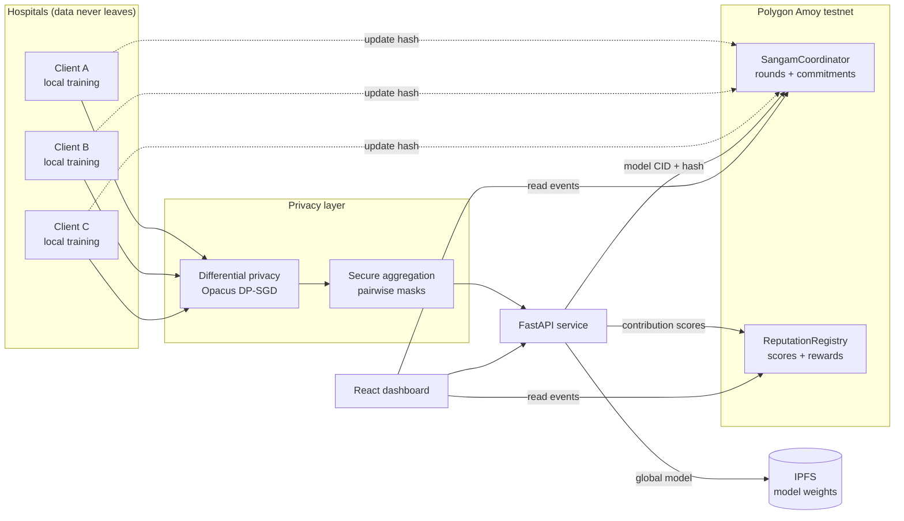

# Sangam

**A blockchain-coordinated framework for privacy-preserving federated learning in healthcare.**

> *Sangam* (संगम) means confluence. At Prayagraj, the Ganga and the Yamuna meet with a third river, the Saraswati, that is never seen but is believed to flow beneath them. That is the idea behind this project: many hospitals contribute to one model, and the most important ingredient, patient data, is never visible.

Hospitals train a shared diagnostic model without moving raw patient records. Smart contracts replace the single trusted aggregator: they run each training round, record a commitment for every update and every global model, score contributions, and keep a permanent audit trail.

| | |
|---|---|
| **Team** | Divyanshh Kalra · Shrey Khandal · Tanish Garg |
| **Guide** | Dr. Mohit Mittal |
| **Institution** | Maharaja Agrasen Institute of Technology, Dept. of CSE-AIML |
| **Domain** | Blockchain · Federated Learning · Applied Privacy |

---

## Contents

1. [Why Sangam](#why-sangam)
2. [Project status](#project-status)
3. [Architecture](#architecture)
4. [Repository layout](#repository-layout)
5. [Quick start](#quick-start)
6. [Configuration](#configuration)
7. [Smart contracts](#smart-contracts)
8. [API reference](#api-reference)
9. [Design system](#design-system)
10. [Evaluation](#evaluation)
11. [Roadmap](#roadmap)
12. [References](#references)

---

## Why Sangam

Standard federated learning (FedAvg) keeps data local but trusts one central server completely. Sangam addresses four problems that setup leaves open.

| Problem | What goes wrong today | How Sangam handles it |
|---|---|---|
| Data silos | Each hospital trains on its own small dataset | Federated training across hospitals, raw data never leaves |
| Central point of trust | One aggregator can fail, go offline, or cheat | Rounds coordinated by smart contracts on a public chain |
| No verifiable contribution | No record of who sent what; poisoned updates go unnoticed | On-chain commitments plus contribution scoring |
| No transparent incentive | Contributors have no fair reward | On-chain reputation and reward registry |

---

## Project status

Progress since the first defence. Update this table before every review.

| Phase | Scope | Status |
|---|---|---|
| 0 · Study and design | Literature review, architecture, threat model | ✅ Done |
| 1 · Federated baseline | FedAvg, local and centralised baselines (Breast Cancer Wisconsin) | ✅ Done |
| 2 · Blockchain coordination | `SangamCoordinator` contract, commitments, audit trail | ✅ Done (local Hardhat, 8 tests passing) |
| 3 · Privacy layer | Secure aggregation (masking) + DP-SGD with RDP accounting | ✅ Done in simulation |
| 4 · Reputation and incentives | Contribution scoring, `ReputationRegistry` | ✅ Done in simulation |
| 5 · Integration and evaluation | Testnet deploy, Flower + Opacus port, dashboard | 🟡 Preliminary evaluation done |

---

## Architecture



**One training round**

1. `SangamCoordinator` opens round *r* and publishes the current global model CID.
2. Each hospital pulls the model from IPFS and trains locally with DP-SGD.
3. Each hospital masks its update and submits `keccak256(update)` on chain.
4. The aggregator sums masked updates. Masks cancel, so only the combined update is revealed.
5. The new global model is pinned to IPFS and its CID and hash are committed on chain.
6. Each contribution is scored (validation gain + similarity to the aggregate). Reputation and rewards update in `ReputationRegistry`.
7. The round closes. Every step is a contract event anyone can verify.

---

## Repository layout

```
sangam/
├── contracts/            # Solidity + Hardhat
│   ├── contracts/
│   │   ├── SangamCoordinator.sol
│   │   └── ReputationRegistry.sol
│   ├── scripts/deploy.ts
│   └── test/
├── fl/                   # Federated learning (Python)
│   ├── client.py         # Flower client (one per hospital)
│   ├── server.py         # Flower server + custom strategy
│   ├── strategy.py       # FedAvg + scoring + chain hooks
│   ├── privacy/
│   │   ├── secagg.py     # pairwise additive masking
│   │   └── dp.py         # Opacus wrapper
│   ├── data.py           # PneumoniaMNIST + non-IID split
│   └── model.py          # small CNN
├── backend/              # FastAPI service
│   └── app/
│       ├── main.py
│       ├── routes/       # rounds, participants, models
│       ├── chain.py      # web3.py contract client
│       └── ipfs.py
├── frontend/             # React + Vite dashboard
│   └── src/
│       ├── styles/tokens.css
│       ├── components/
│       └── pages/        # Overview, Rounds, Participants, Audit
├── docs/                 # architecture, threat model, paper draft
└── README.md
```

---

## Quick start

### Prerequisites

| Tool | Version |
|---|---|
| Node.js | 20 LTS |
| Python | 3.11 |
| IPFS Kubo | 0.29+ |
| MetaMask | any recent |

### 1. Clone

```bash
git clone https://github.com/<your-org>/sangam.git
cd sangam
```

### 2. Smart contracts

```bash
cd contracts
npm install
npx hardhat test                                   # run contract tests
npx hardhat node                                   # local chain on :8545 (keep open)
npx hardhat run scripts/deploy.ts --network localhost
```

Deploy to Polygon Amoy instead:

```bash
npx hardhat run scripts/deploy.ts --network amoy
```

The deploy script writes contract addresses to `backend/.env` and `frontend/.env`.

### 3. IPFS

```bash
ipfs init        # first time only
ipfs daemon      # API on :5001
```

### 4. Backend

```bash
cd backend
python -m venv .venv && source .venv/bin/activate   # Windows: .venv\Scripts\activate
pip install -r requirements.txt
uvicorn app.main:app --reload --port 8000
```

API docs are at `http://localhost:8000/docs`.

### 5. Federated training

Open one terminal for the server and one per hospital.

```bash
cd fl
pip install -r requirements.txt

python server.py --rounds 10 --min-clients 3
python client.py --hospital-id 0
python client.py --hospital-id 1
python client.py --hospital-id 2
```

To simulate a malicious hospital for robustness tests:

```bash
python client.py --hospital-id 3 --attack label-flip
```

### 6. Frontend

```bash
cd frontend
npm install
npm run dev        # http://localhost:5173
```

---

## Configuration

`backend/.env`

```env
RPC_URL=http://127.0.0.1:8545
COORDINATOR_ADDRESS=0x...
REGISTRY_ADDRESS=0x...
AGGREGATOR_PRIVATE_KEY=0x...      # never commit this
IPFS_API=http://127.0.0.1:5001
```

`fl/config.yaml`

```yaml
dataset: pneumoniamnist
num_hospitals: 4
dirichlet_alpha: 0.5     # lower = more non-IID
local_epochs: 2
batch_size: 64
lr: 0.01
dp:
  enabled: true
  noise_multiplier: 1.1
  max_grad_norm: 1.0
  target_delta: 1.0e-5
secagg:
  enabled: true
```

---

## Smart contracts

### `SangamCoordinator.sol`

| Function | Caller | Purpose |
|---|---|---|
| `registerParticipant(address)` | Owner | Admit a hospital |
| `openRound(bytes32 modelHash, string cid)` | Aggregator | Start round with current global model |
| `submitUpdate(uint256 round, bytes32 updateHash)` | Hospital | Commit to a local update |
| `commitGlobalModel(uint256 round, bytes32 hash, string cid)` | Aggregator | Record new global model |
| `closeRound(uint256 round)` | Aggregator | Finalise the round |

Events: `RoundOpened`, `UpdateSubmitted`, `GlobalModelCommitted`, `RoundClosed`. The dashboard's audit view is built entirely from these events.

### `ReputationRegistry.sol`

| Function | Purpose |
|---|---|
| `recordScore(uint256 round, address p, uint256 score)` | Store a contribution score (0 to 10 000) |
| `reputationOf(address p)` | Exponential moving average of past scores |
| `rewardOf(address p)` | Accumulated reward points |

Only commitments and metadata go on chain. Weights live on IPFS.

---

## API reference

| Method | Endpoint | Returns |
|---|---|---|
| `GET` | `/rounds` | All rounds with status and accuracy |
| `GET` | `/rounds/{id}` | Round detail, update hashes, model CID |
| `GET` | `/participants` | Hospitals with reputation and reward |
| `GET` | `/models/{cid}` | Global model metadata |
| `GET` | `/audit` | Verified event log from the chain |
| `POST` | `/rounds/open` | Open a new round (aggregator only) |

---

## Design system

The dashboard has one job: let an evaluator, auditor, or hospital admin see that the process is honest. The design follows from that.

### Principles

The interface mixes three styles, each with a fixed role, so the mix reads as deliberate rather than random.

| Style | Share | Where it is used | Why |
|---|---|---|---|
| **Minimalism** | ~70% | Page layout, tables, forms, body text | Medical and audit data needs calm and space |
| **Brutalism** (light) | ~20% | Hashes, contract addresses, round cards, audit log | Raw, exposed borders signal "nothing hidden here" |
| **Maximalism** | ~10% | The confluence view on the Overview page only | One rich moment that shows the idea of Sangam |

Rule of thumb: if a screen has no on-chain data, it is minimal. If it shows chain data, it gets the brutalist frame. Only the confluence visual is allowed to be loud.

### Colour

Named after the three rivers. Saraswati, the hidden one, is used for anything private.

```css
:root {
  /* Base */
  --paper:      #F6F2EA;   /* warm off-white background */
  --surface:    #FFFDF8;
  --ink:        #1A1A1A;   /* text and brutalist borders */
  --ink-soft:   #5C5852;
  --rule:       #E2DCD0;

  /* Rivers */
  --ganga:      #C8963E;   /* ochre: primary actions, global model */
  --yamuna:     #23336B;   /* indigo: chain, verification, links */
  --saraswati:  #8A7CC2;   /* muted violet: privacy, DP, masked data */

  /* States */
  --verified:   #2F7D5B;
  --flagged:    #B4432F;   /* poisoned or rejected update */
  --pending:    #C8963E;
}

@media (prefers-color-scheme: dark) {
  :root:not([data-theme="light"]) {
    --paper:     #14130F;
    --surface:   #1D1B17;
    --ink:       #F1ECE2;
    --ink-soft:  #A39D92;
    --rule:      #34312B;
    --ganga:     #E0B05A;
    --yamuna:    #8EA2E8;
    --saraswati: #B3A6E6;
  }
}
```

### Type

| Role | Font | Notes |
|---|---|---|
| Display | **Fraunces** | Page titles and big numbers only |
| Body / UI | **IBM Plex Sans** | Everything else |
| Data | **IBM Plex Mono** | Hashes, addresses, CIDs, round numbers |

Scale: 13 · 15 · 18 · 24 · 36 · 56 px. Hashes are always mono, always truncated in the middle (`0x3fa2…9c1d`), and copyable on click.

### Shape

```css
--radius-pill: 999px;   /* every button */
--radius-card: 14px;    /* minimal cards */
--radius-none: 0;       /* brutalist chain cards */

--border-brutal: 2px solid var(--ink);
--shadow-brutal: 4px 4px 0 var(--ink);  /* hard offset, no blur */
--shadow-soft:   0 1px 2px rgb(0 0 0 / 0.06);
```

**Buttons are always pill-shaped.** Curves for things you press, hard corners for things you verify. That contrast is the core of the visual language.

| Button | Style |
|---|---|
| Primary | Pill, `--ganga` fill, `--ink` text |
| Secondary | Pill, 1.5px `--ink` outline, transparent |
| Chain action (e.g. *Verify on chain*) | Pill, `--yamuna` fill, plus the brutal offset shadow; shadow collapses on press |

### Components

- **Round card** (brutalist): square corners, 2px ink border, hard shadow, mono round number, status chip.
- **Hash chip**: mono text on `--rule` background, copy icon, links to block explorer.
- **Participant row** (minimal): hospital name, reputation bar in `--ganga`, reward in mono.
- **Privacy badge**: `--saraswati` outline pill showing ε (epsilon) spent so far.
- **Confluence view** (maximal): each hospital is a coloured stream flowing into the centre, width proportional to its contribution score, a third faint violet stream underneath for the hidden data. Animates once per round. This is the only gradient in the product.

### Pages

| Page | What it shows |
|---|---|
| Overview | Confluence view, current round, global accuracy, ε spent |
| Rounds | Grid of round cards, accuracy chart |
| Participants | Reputation table, flagged updates |
| Audit | Raw event log from the chain, verify-hash tool |

### What we avoid

Purple-to-blue gradients, glassmorphism, emoji icons, stock "AI brain" imagery, and centred hero sections with a vague tagline. Every visual element should map to a real piece of data.

---

## Evaluation

**Dataset (preliminary results):** Breast Cancer Wisconsin (Diagnostic), 569 cases, 30 features, bundled with scikit-learn. **Next phase:** PneumoniaMNIST from [MedMNIST v2](https://medmnist.com/) (chest X-rays). Split across 4 hospitals with a Dirichlet(α = 0.5) partition to simulate non-IID data.

| Experiment | Question |
|---|---|
| Centralised vs FedAvg vs Sangam | How much accuracy does decentralisation cost? |
| ε sweep (1, 3, 8, ∞) | Privacy vs accuracy trade-off |
| 1 of 4 clients label-flipping | Does scoring detect and down-weight the attacker? |
| Free-rider (sends random noise) | Does reputation drop to near zero? |
| Gas and latency per round | Is on-chain coordination practical? |

Metrics: accuracy, AUC, F1, ε, attack success rate, gas used, round time.

Results go in `docs/results.md` as experiments finish.

---

## Roadmap

- [x] Architecture and threat model
- [x] FedAvg baseline on PneumoniaMNIST
- [x] Coordinator and reputation contracts (local Hardhat, 8 tests passing)
- [x] Secure aggregation with pairwise masking (simulation)
- [x] DP-SGD and ε accounting (simulation)
- [x] Contribution scoring and reputation (simulation)
- [ ] Deploy contracts to Amoy testnet
- [ ] Dashboard with audit view
- [ ] Full evaluation and paper submission

**Future scope:** zero-knowledge proofs of correct aggregation, larger hospital consortia, alignment with India's DPDP Act 2023 and the Ayushman Bharat Digital Mission.

---

## References

1. McMahan et al. *Communication-Efficient Learning of Deep Networks from Decentralized Data.* AISTATS, 2017.
2. Bonawitz et al. *Practical Secure Aggregation for Privacy-Preserving Machine Learning.* ACM CCS, 2017.
3. Abadi et al. *Deep Learning with Differential Privacy.* ACM CCS, 2016.
4. Beutel et al. *Flower: A Friendly Federated Learning Framework.* arXiv:2007.14390, 2020.
5. Wood, G. *Ethereum: A Secure Decentralised Generalised Transaction Ledger.* Yellow Paper.
6. Benet, J. *IPFS: Content Addressed, Versioned, P2P File System.* arXiv:1407.3561, 2014.
7. Yang et al. *MedMNIST v2: A Large-Scale Lightweight Benchmark for 2D and 3D Biomedical Image Classification.* Scientific Data, 2023.

---

<sub>Minor project · Department of CSE-AIML · Maharaja Agrasen Institute of Technology</sub>
