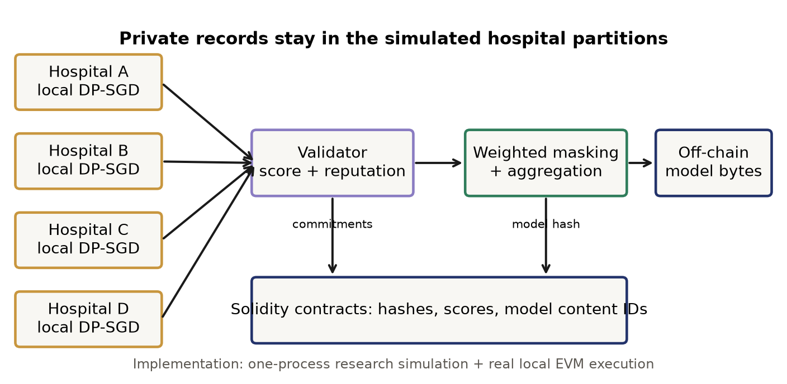
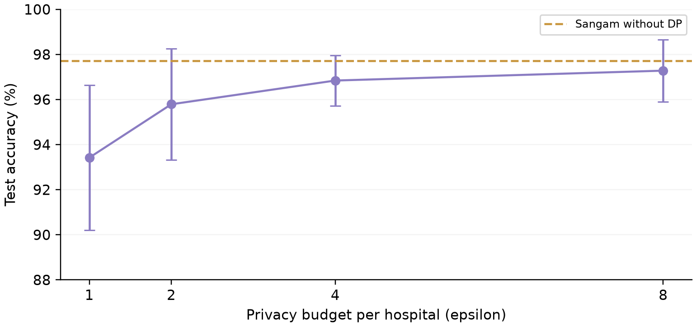

# Sangam: A Blockchain-Coordinated Prototype for Auditable Federated Learning in Healthcare

Divyanshh Kalra, Shrey Khandal, Tanish Garg, and Dr. Mohit Mittal

Department of CSE-AIML, Maharaja Agrasen Institute of Technology, Rohini, New Delhi, India

## Abstract

Hospitals can collaborate on diagnostic models without pooling patient records, but ordinary federated averaging relies on an aggregation service and provides little persistent evidence about contributions. Sangam is a reproducible prototype combining contribution scoring, asymmetric reputation, experimental privacy accounting, and Solidity-based coordination. Four simulated hospitals train a 513-parameter model on the Breast Cancer Wisconsin benchmark. Across ten seeds, non-private Sangam achieves 97.72 ± 0.80% test accuracy, compared with 97.63 ± 1.11% for FedAvg. Under a sign-flipping client, these figures are 97.19 ± 1.10% and 35.61 ± 28.92%, respectively. A separate privacy sweep reaches 96.84 ± 1.12% at epsilon 4 and delta 10^-5. The integrated service executes actual local-Ethereum transactions and verifies stored model bytes against their on-chain commitment. The implementation remains a one-process research simulation: masking is arithmetic rather than a production cryptographic protocol, validators inspect individual updates, and testnet deployment is not claimed. The contribution is transparent integration and reproducible evaluation, rather than a new privacy proof or clinical validation.

Keywords: federated learning; blockchain coordination; reputation; differential privacy; secure aggregation simulation; healthcare benchmark.

## 1. Introduction

Medical datasets are often distributed across institutions. Federated learning exchanges model updates instead of pooling the underlying records [1], but a standard server still determines how contributions are combined. An audit log can make model provenance and contribution history visible without recording patient records on chain. Update confidentiality and robustness remain separate requirements: hashes do not hide an update already disclosed to a validator, and an immutable log does not establish that an update is correct.

Sangam connects these concerns in a small benchmark prototype. Hospitals contribute updates; a validation role scores them; persistent reputations determine aggregation weights; a masking simulation demonstrates sum recovery; and two contracts enforce a round lifecycle and record contribution scores. A dashboard exposes measured results and actual transaction receipts. We ask three practical questions: how much utility is retained relative to ordinary baselines, how the weighting reacts to simple malicious clients, and what privacy-accounting and chain overhead accompany the design.

The contributions are (i) an executable integration with content-addressed model storage and contract-level provenance, (ii) a ten-seed comparison including privacy and attack experiments, and (iii) explicit correspondence between the published evidence, implementation, and limitations. We do not claim novelty for FedAvg, DP-SGD, additive masking, or reputation updates individually, nor superiority over all robust aggregation methods.

## 2. Related work and research positioning

FedAvg averages locally trained parameters according to client data sizes [1]. Secure aggregation protocols can reveal only a combined update, but require cryptographic setup and mechanisms for failed or malicious clients [2]. DP-SGD clips per-example gradients and adds calibrated Gaussian noise [3]; Rényi differential privacy provides a composition framework [4,5]. These mechanisms address different information flows and cannot be substituted for each other.

The coordinate-wise median is a standard robust baseline [6]. FLTrust uses a trusted root dataset to assess client updates [7]. Blockchain approaches such as BlockFL and DeepChain explore coordination, auditability, or incentives [9,10]. Sangam is positioned as an integration study: a small, inspectable implementation showing how these roles interact. Reputation points are accounting units, not a financial reward, and recording a score on chain does not prove the scoring service behaved honestly.

## 3. System and threat model

The design has four hospital roles, a validator, an aggregator, two Ethereum-compatible contracts, and off-chain model storage. The consortium owner admits participants. The validator sees individual updates and a held-out validation set; the aggregator combines weighted updates. In this implementation all learning roles share one Python process and data are partitioned in memory. This reproduces the algorithm but does not demonstrate institutional isolation or a distributed network protocol.

The experimental attacker is hospital D. We separately test flipped labels, an update multiplied by -5, and a free rider that supplies norm-scaled Gaussian noise instead of training. We assume the coordinator and validator follow their prescribed computations. Sybil admission, validator collusion, adaptive attacks, verified dataset sizes, and patient-level reconstruction attacks are outside the evaluation. Fewer than half the clients are malicious in the tested setting; that is an experimental condition, not a general robustness theorem.

## 4. Methodology

Let w be the global parameter vector and d_k a hospital update. Each client runs two local epochs. In a private experiment, each record is sampled independently with q_k=min(1,b/n_k), its gradient is clipped to norm C=1, and Gaussian noise with standard deviation sigma_k C is added to the gradient sum before division by the expected batch size. Sigma_k is calibrated for all 30 rounds using integer RDP orders 2 through 128 and delta=10^-5 [3–5]. The same accountant evaluates the accumulated honest-client budget. Seeds are fixed for reproducibility on a public benchmark, not used as secret production randomness.

Updates are bounded to the median client-update norm. The validator computes cosine agreement with the coordinate-wise median and the relative validation-loss improvement gamma_k. The contribution score is s_k = max(0,cos_k)/max_j max(0,cos_j) times min(1,2 sigmoid(20 gamma_k)). This is a heuristic consistency-and-utility score, not a proof of honesty. A participant may occasionally align by chance, which is particularly relevant for free riding.

Reputation starts at 0.5. If a score is below half the round median, reputation is halved; otherwise r_k becomes 0.8 r_k + 0.2 s_k. Clients below one quarter of the maximum reputation receive zero weight. Remaining weights are proportional to n_k r_k and normalized to sum to one. The integrated path uses the contract’s integer scores and reputations, while research simulations use floating point. These two implementations can produce slightly different trajectories; their evidence is reported separately.

For masking, updates are multiplied by their weights, quantized with 20 fractional bits, and represented modulo 2^32. Equal and opposite pseudorandom pairwise masks cancel when summed. The implementation demonstrates cancellation and quantization accuracy. It does not implement authenticated pairwise key exchange, dropout recovery, or a proof binding a masked input to its committed unmasked update. Because the validator receives individual updates, it retains more visibility than the logical aggregation role.

## 5. Implementation and reproducibility

SangamCoordinator restricts participant admission and round management, rejects duplicate and late submissions, records starting and global-model hashes/content IDs, and enforces Open → Aggregated → Closed transitions. ReputationRegistry accepts one score batch per participant and round, computes the asymmetric update in basis points, and accumulates reward points. Solidity 0.8.24 is compiled with 200 optimizer runs. The integrated service uses Web3 and an in-process Ethereum test chain; it does not claim Polygon Amoy transactions.

FastAPI exposes runs, rounds, participants, model downloads, and hash verification. Read endpoints are public; experiment creation requires a private operator token. The service submits transactions for the simulated hospital accounts. React displays API values rather than generated curves. Model artifacts are little-endian float64 bytes, keyed by a SHA-256 raw CIDv1; their Keccak-256 commitments are checked against the contracts. SQLite supports a local run and PostgreSQL/Supabase supports hosted persistence. These content-addressed objects are not described as publicly pinned to IPFS.

The public UCI diagnostic dataset [8] contains 569 cases and 30 features. A stratified 20% test holdout gives 114 cases. The implemented 7% validation allocation gives 40 validation cases and leaves 415 training cases. Training features are standardized using pooled training statistics in the simulation; a real deployment would need a public or privacy-aware normalization protocol. The training cases are distributed across four hospitals using a Dirichlet label partition with alpha=0.5 and a minimum 8% share of each class per client. Thus the partition is non-IID but deliberately avoids nearly empty clients.

The model is a 30–16–1 ReLU/sigmoid MLP with 513 parameters. We run 30 rounds, two local epochs, batch size 16, and learning rate 0.1. Baselines are centralized training, the mean of four local-only models, size-weighted FedAvg, and coordinate-wise median aggregation. The ten seeds are 0–9. Tables report mean and population standard deviation (ddof=0). F1 treats benign cases, dataset label 1, as positive. These conventions are explicit because benign-positive F1 is not malignant-case sensitivity.

Reproduction commands and per-seed outputs are included with the repository. Privacy sweeps and robustness experiments are separate: the attack comparison is non-private and cannot establish joint DP-plus-poisoning performance. The centralized and federated procedures use the specified local-epoch schedules, which do not equalize all optimization steps or computational budgets. Results are exploratory benchmark evidence, not clinical effectiveness estimates.

## 6. Results

Table 1. Honest-case utility, mean ± SD over ten seeds.

| Method | Accuracy % | ROC-AUC % | F1 % |

| --- | --- | --- | --- |

| Centralised | 97.54 ± 1.23 | 99.77 ± 0.22 | 98.05 ± 0.97 |

| Local only | 96.21 ± 1.21 | 99.46 ± 0.33 | 96.97 ± 1.01 |

| FedAvg | 97.63 ± 1.11 | 99.76 ± 0.21 | 98.13 ± 0.88 |

| Median | 97.89 ± 0.89 | 99.71 ± 0.25 | 98.34 ± 0.71 |

| Sangam | 97.72 ± 0.80 | 99.72 ± 0.19 | 98.20 ± 0.63 |

| Sangam, DP 4 | 96.84 ± 1.12 | 99.57 ± 0.27 | 97.48 ± 0.90 |

Non-private Sangam retains high accuracy but does not dominate the median baseline. Its mean is 0.09 percentage points above FedAvg and 1.51 points above local-only training. The small benchmark and overlapping variability do not support a general superiority claim. The integrated single-seed run uses contract quantization and is not substituted for the multi-seed table.

Table 2. Non-private attack comparison, mean ± SD (%).

| Attack | FedAvg acc. | Median acc. | Sangam acc. |

| --- | --- | --- | --- |

| Label Flip | 87.11 ± 11.08 | 97.11 ± 0.79 | 97.19 ± 1.23 |

| Sign Flip | 35.61 ± 28.92 | 96.58 ± 1.49 | 97.19 ± 1.10 |

| Free Rider | 96.93 ± 1.32 | 97.28 ± 1.14 | 97.11 ± 1.11 |

Sangam and the median remain near 97% for the tested label- and sign-flipping attacks. FedAvg is especially unstable under sign flipping, with a large across-seed deviation. This is consistent with sensitivity to an adversarial client’s data share. Sangam’s mean attacker influence is 2.06% for label flipping and 2.95% for sign flipping, compared with 23.44% for the honest control. Free-rider influence remains 12.09%; suppression is partial, not complete.

The integrated honest run completes 30 rounds and 240 actual round transactions. The mean round gas is 842,351, with first-round gas 1,069,097 and a range of 813,247–1,069,097. These receipts include real content IDs and contract storage updates on the local EVM; they are not the old draft’s 668,449-gas estimate. Timing includes training, contract execution, accounting, and persistence, so it is not a network latency benchmark. Model downloads are verified byte-for-byte against Keccak commitments.

## 7. Limitations and future work

The experiment uses one small tabular dataset and four simulated clients. A curated validation set is trusted, and global normalization is centralized in the simulator. Neither a hospital-grade deployment nor a clinical use claim is justified. Private training uses a custom accountant and reproducible statistical experiments; production use would require audited accounting, secret randomness, a preprocessing privacy analysis, and secure client isolation.

Scoring reveals individual DP-protected updates to validators. The arithmetic masking simulation alone is not a production confidentiality guarantee. The protocol does not prove that a masked input matches its on-chain hash, that a model was correctly aggregated, or that claimed client dataset sizes are truthful. Reputation is heuristic and only partly detects free riding. Medical-imaging benchmarks, more clients, adaptive attacks, independent hospital processes, authenticated key agreement, verifiable aggregation, and public-testnet deployment are future work.

## 8. Conclusion

Sangam demonstrates a coherent path from federated training to recorded contribution history and model provenance. Reproduced experiments show useful honest-case utility, a privacy–utility trade-off, and resistance to simple poisoning attacks comparable to a robust median baseline. The local-EVM integration provides inspectable receipts and verifiable model artifacts. Its value for this submission is a working, reproducible prototype with bounded claims and explicit limitations.

## Data and code availability

The data are public through UCI and scikit-learn [8]. Source code, configuration, per-seed experiment outputs, local-EVM receipts, and figure-generation sources are available in the Sangam repository [11]. No private patient records were collected. The interactive dashboard and evaluation outputs represent different runs and are labelled accordingly.

## Declarations

This work used an existing public, de-identified benchmark and did not recruit human participants. No external project funding is claimed. Generative AI assisted implementation, manuscript drafting, document layout, and verification; the authors remain responsible for checking the code, references, measurements, and final text.

## References

[1] B. McMahan et al., “Communication-Efficient Learning of Deep Networks from Decentralized Data,” AISTATS, PMLR 54, pp. 1273–1282, 2017. https://proceedings.mlr.press/v54/mcmahan17a.html

[2] K. Bonawitz et al., “Practical Secure Aggregation for Privacy-Preserving Machine Learning,” ACM CCS, 2017. doi:10.1145/3133956.3133982.

[3] M. Abadi et al., “Deep Learning with Differential Privacy,” ACM CCS, 2016. doi:10.1145/2976749.2978318.

[4] I. Mironov, “Rényi Differential Privacy,” IEEE CSF, 2017. doi:10.1109/CSF.2017.11.

[5] I. Mironov, K. Talwar and L. Zhang, “Rényi Differential Privacy of the Sampled Gaussian Mechanism,” 2019. arXiv:1908.10530.

[6] D. Yin et al., “Byzantine-Robust Distributed Learning: Towards Optimal Statistical Rates,” ICML, PMLR 80, pp. 5650–5659, 2018. https://proceedings.mlr.press/v80/yin18a.html

[7] X. Cao et al., “FLTrust: Byzantine-Robust Federated Learning via Trust Bootstrapping,” NDSS, 2021. doi:10.14722/ndss.2021.24434.

[8] W. Wolberg, O. Mangasarian, N. Street and W. Street, “Breast Cancer Wisconsin (Diagnostic),” UCI Machine Learning Repository, 1995. doi:10.24432/C5DW2B.

[9] H. Kim, J. Park, M. Bennis and S.-L. Kim, “Blockchained On-Device Federated Learning,” IEEE Communications Letters, vol. 24, no. 6, pp. 1279–1283, 2020. doi:10.1109/LCOMM.2019.2921755.

[10] J. Weng et al., “DeepChain: Auditable and Privacy-Preserving Deep Learning with Blockchain-Based Incentive,” IEEE Transactions on Dependable and Secure Computing, vol. 18, no. 5, pp. 2438–2455, 2021. doi:10.1109/TDSC.2019.2952332.

[11] Sangam source code and reproducibility materials. https://github.com/TechnicallyKiller/sangam/tree/submission/final-defence (accessed 16 November 2026).
